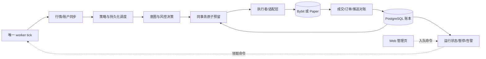

# 架构决策记录（ADR）

创建日期：2026-11-17。适用版本：当前仓库 `main`（含 PR #8 的 P0 证据补齐）。

这份文档记录**已经做出并落地**的架构选择及其理由，不是新设计提案。需求与验收口径以 [requirements.md](requirements.md)、[acceptance.md](acceptance.md) 为准；本文件回答"为什么是这样，而不是别的"。每条决策都标注当前证据状态，不把设计意图等同于实盘能力。

## 0. 一句话总览

一个 **Python 模块化单体 + PostgreSQL 单一事实源**：唯一 worker 顺序驱动"行情 → 策略/调度 → 意图 → 原子预留 → 唯一执行者 → 成交 → 账本 → 风控/对账反馈"闭环；Web 只读并只入队人工命令；任何证据不足都**暂停新增风险但保留可信退出通道**，人工控制与恢复需审计。

## ADR-001：模块化单体，单进程 worker（不做微服务/事件总线）

- **状态**：已接受并落地。
- **背景**：首期容量为 1 账户、≤5 策略、≤10 现货对、≤200 期权候选、意图 ≤1 次/秒（NFR-01）。最终一致性、服务发现、跨服务事务都不是主要矛盾；主要矛盾是订单与资金**不能**出现并发歧义。
- **决策**：一个 `TradingService.tick` 顺序驱动行情、账户、调度、风控、执行、对账、状态与告警；模块按边界拆包（`adapters/`、`risk/`、`execution/`、`validation/`、`ops/`、`web/`），但共用同一个 Postgres 与进程内状态。Web 是独立 FastAPI 进程，只读数据库且只写控制命令表，不直接交易。
- **理由**：把"意图→预留→订单→成交"放在一个事务边界和一个执行序列里，比跨服务编排更容易证明不变量；单体也便于单执行者租约和确定性测试。Web 重启不会生成第二个交易执行者。
- **否决的备选**：微服务拆分（增加分布式事务与对账复杂度，无容量收益）；纯事件驱动（事件重放顺序与幂等在首期难以证明，且不能消除对账需求）。
- **代价/边界**：worker 是单点；可用性依赖 Postgres 与外部监控（OPS-05）。后续要扩展吞吐应先强化租约与分区，而不是直接拆服务。

## ADR-002：PostgreSQL 是唯一事实源，业务事实只追加

- **状态**：已接受并落地；长期保留仍无实跑证据。
- **背景**：交易系统必须能回答"当时为何下单、占用了谁的额度、后来发生了什么"，且进程重启不能改变历史。
- **决策**：意图、风控决定、预留、订单、成交、库存、账本事件、暂停、命令、告警、租约、运行状态统一落库（共 23 张核心表，见 `db/models.py`）。账本纠错写更正事件（`correction_of_id`），不原地改历史；成交去重域为"环境 + 产品 + 交易所成交编号"（`uq_execution_dedupe`）；费用保留原币种与估值信息。`RetentionCleaner` 只回收未被决策引用的原始行情，账务/审计一律不删。
- **理由**：追加式账本能把"事实"与"解释"分开，去重域能防止交易所重复推送造成双算；保留策略把决策证据与可从行情源重取的原始数据区别对待，避免 `ON DELETE SET NULL` 静默抹掉 `trade_intent.quote_snapshot_id`。
- **否决的备选**：以交易所历史为唯一账本（历史可能不完整、无策略归属、无决策依据）；原地 UPDATE 纠错（破坏不可抵赖性）；定时清空全部行情（会丢决策快照）。
- **代价/边界**：磁盘增长需持续观测（已纳入 AC-22）；1 年保留是配置与实现约束，不是实跑结论。

## ADR-003：意图 / 风控 / 预留在同一持久化事务中完成

- **状态**：已接受并落地；双策略额度竞争的部分组合场景仍在待验清单（AC-07）。
- **背景**：RSK-02 要求资金与可平数量在同一事务校验并预留，计入有效挂单、部分成交剩余量与 UNKNOWN 请求；交易所冻结与本地预留不能双扣或漏算。
- **决策**：`risk/reservation.py` 用事务级 Postgres 咨询锁按 `环境:币种` / `环境:合约` 串行化；预算视图只计自有未占用现金，不把抵押品、浮盈或可借额度当额度；所有未知/待发送/部分成交余量继续占额度；`RiskDecision` 与 `Reservation` 同意图一并落库。
- **理由**：把"检查"和"占用"放在同一事务里，避免两个策略同时通过检查后各自预留导致超支；现金与库存分锁减少无谓冲突。
- **否决的备选**：应用内内存锁（多进程/重启失效）；先检查后异步预留（TOCTOU）；按交易所可用余额单独决策（未反映本地在途预留）。
- **代价/边界**：锁按币种/合约粒度，热点品种会串行；这是安全方向。外部资金变化只能在同步周期后被发现。

## ADR-004：一个执行者，租约 ≠ 发单资格

- **状态**：已接受并落地；真实双进程竞争与断连组合尚未演练（AC-12）。
- **背景**：EXE-05 要求每账户最多一个发单者；数据库锁超时本身不能证明旧进程已停止。
- **决策**：`execution/lease.py` 使用**会话级** `pg_try_advisory_lock`（连接断开即失权），拿到锁只进入 `NEEDS_CONFIRMATION`；必须由运维显式执行 `CONFIRM_TAKEOVER` 才进入 `ELIGIBLE`。失权时所有在途请求按 UNKNOWN 处理，不允许换编号重发。
- **理由**：事务级锁会随提交释放，覆盖不了长生命周期 worker；会话级锁与数据库连接共存亡，天然实现"断连即失权"。把"拿到锁"和"证明旧执行者已停止"分开，是为了不让网络分区变成重复下单。
- **否决的备选**：仅用一行租约表 + 心跳超时自动接管（心跳延迟不等于进程死亡）；事务级锁（生命周期不符）；多主执行（首期容量不需要，且放大重复风险）。
- **代价/边界**：重启后需要人工确认接管，可用性换安全性；这正是要求的行为。

## ADR-005：订单业务状态与同步可信度正交，UNKNOWN 不是终态

- **状态**：已接受并落地；四个崩溃点的真实子进程演练仍未完成（AC-09）。
- **背景**：超时、发送中崩溃、重复 orderLinkId 响应都可能让"订单是否受理"不可判定；旧事件不能倒退终态，但晚到的真实成交必须入账。
- **决策**：`execution/states.py` 把 `status`（PREPARED/SUBMITTING/ACCEPTED/.../EXPIRED/UNKNOWN）与 `sync_state`（NONE/PENDING/CONFIRMED/UNCERTAIN）分开保存；终态不可倒退、成交数量单调不减；`EXPIRED` 只表示已确认的交易所失效，本地 TTL 只触发撤单。UNKNOWN 只能由订单事实、明确拒绝或可信的"未发送"证据消除，人工点击不算证据（EXE-02）；重复编号错误码按 UNKNOWN 处理。
- **理由**：把"业务走到哪一步"和"我们是否知道"分开，才能表达"部分成交 + 结果未知"这种真实状态；把 UNKNOWN 设为可解析状态而不是终态，避免丢掉后来到达的成交。
- **否决的备选**：重试即换 orderLinkId（可能重复下单）；超时即判失败并释放预留（丢真实成交）；单一 status 字段（无法表达"已成交但同步不确定"）。
- **代价/边界**：恢复流程复杂，必须有订单/成交查询与推送交叉验证；人工接管页面需展示证据，不能只给"确认"按钮。

## ADR-006：暂停分两层，解除需要证据闸门；时钟跳变是锁定暂停

- **状态**：已接受并落地；真实环境告警送达仍待验（AC-18/20）。
- **背景**：数据失效、行情过期是技术性问题，重新同步后可自动恢复；亏损熔断、未知订单、外部改仓、恢复演练是安全问题，不能由系统自愈。
- **决策**：`ops/pauses.py` 的 `RiskPause.locked` 区分技术暂停与锁定暂停；技术暂停清除前要求重新同步且全部检查通过（身份、对账、基线、估值、租约、无负债、无未知订单）；锁定暂停只能走带审计的人工 `RESUME`，重启与换日都不解除。`CLOCK_JUMP` 被加入锁定原因：调度时刻失去可信度，技术重同步不能替代人工确认。`PAUSED_OPEN` 只禁止新增风险，仍允许可信且可审计的退出/撤单（RSK-04）；`STOPPED` 不等于已平仓（OPS-05）。
- **理由**：把"数据现在不好"和"系统不再被信任"分开，既能自动恢复暂时故障，又不会用旧估值或旧基线解除安全熔断。
- **否决的备选**：所有暂停统一人工解除（暂时断流也要人盯，不可持续）；所有暂停自动超时恢复（可能用未知状态重新开仓）；暂停时禁止一切操作（连可信退出都停，风险更大）。
- **代价/边界**：技术恢复的判定条件必须逐条断言（AC-26 已覆盖时钟场景）；锁定暂停要求操作手册和审计记录。

## ADR-007：持久化调度，错过即跳过；限速延后而非丢弃

- **状态**：已接受并落地；生产主机实际时钟跳变未实测。
- **背景**：STR-02 明确禁止停机后集中补买；NFR-01 要求合计 ≤1 意图/秒。两个策略的日历时刻可能落在同一秒 —— 限速若实现成"拒单"，会让其中一个策略当天静默不交易。
- **决策**：`scheduler.py` 用 `(环境, 去重键)` 唯一约束保证同一 UTC 秒只登记一次任务；`claim_due` 超过 60s 宽限期标记 `SKIPPED/missed`，绝不补买。撞上每秒上限时 `Scheduler.defer` 把任务放回 `PLANNED`（不改 `planned_at`/去重键），下个周期重抢；时钟跳变检测与交易所偏差测量使用可注入的 `ClockWatch`，超时/退避走单调钟。
- **理由**："不补买"约束的是**陈旧信号**，不是"同一秒的第二个有效计划"。延后既不突破速率上限，也不丢计划；超过宽限期仍跳过，保持禁止补买语义。限速由单调钟驱动，墙钟跳变不能改变速率判定。
- **否决的备选**：超限直接跳过（导致沙盒验收真实失败：两个策略只落地一个订单）；无限队列排队（可能集中补做）；按墙钟限流（跳变时窗口错乱）。
- **代价/边界**：同秒计划会分摊到不同调度周期；策略日历扎堆时需复核。延后有界（60s 宽限期）。

## ADR-008：Paper 是确定性可重复模拟，不冒充真实成交能力

- **状态**：已接受并落地；真实 Demo/Testnet 能力仍未验证（AC-24）。
- **背景**：需要端到端验证策略→风控→执行→账本，但不能把模拟结果当成真实可成交性证明。
- **决策**：`adapters/paper.py` 以"意图后的下一份有效盘口"为最早成交时点，买限价触及卖盘/卖限价触及买盘时按价格优先消耗可见深度；所有模拟订单共享深度扣减、顺序固定；支持部分成交、撤单与结果未知故障注入；费用用版本化模型；不模拟排队、延迟、市场冲击。`sandbox.py` 新建独立 schema 与固定合成行情，验证从启动到重启恢复的闭环。策略只生成标准意图，不接触密钥或交易写接口。
- **理由**：确定性模型能让同一输入重放得到同一结果，适合验收；明确披露不刻画真实撮合，避免把 paper 收益当实盘能力。
- **否决的备选**：用标记价瞬间全额成交（会产生误导性收益报告）；直接接真实账户调试（无凭据且违反阶段门槛）。
- **代价/边界**：paper 的"全部通过"不能折算为真实成交、撤单、reduceOnly 或期权单位正确；这些是 M3 准入门槛。

## ADR-009：验证研究链路与产品交易链路隔离但共用底层不变量

- **状态**：已接受并落地（阶段四验证中心）。
- **背景**：研究用的价差四腿协议需要冻结证据、事件哈希链、计划先提交后执行、重放复用同一信号身份；但它不是通用交易策略，不能绕开产品风控与账本。
- **决策**：`validation/` 独立管理采样身份、协议、观察、归档、生命周期与编排；验证意图经标准 `TradeIntent`/`Order`/`Execution` 链路落地，成交事实重新投影（含撤单后晚到成交）；原始研究清单与产物不改，冻结清单与哈希链保证证据可校验；运行期可暂停/停止验证，启动前校验当前 checkout 与冻结清单一致。
- **理由**：把"研究证据完整性"与"产品执行可靠性"解耦：研究侧要求证据不可改，产品侧要求所有交易走同一条可审计链路。
- **否决的备选**：验证逻辑直接调用交易所（绕过风控与账本）；把研究原始记录改写为产品格式（破坏原研究协议）。
- **代价/边界**：验证与常规策略共享意图限速与暂停闸门；同时运行需互斥与容量评估。

## ADR-010：人工控制通过持久化命令队列，Web 永不直接发单

- **状态**：已接受并落地；页面逐项展示断言与真实通知渠道待验（AC-19/20）。
- **背景**：OPS-02/SEC-02 要求暂停、撤单、受限减仓、恢复等动作有唯一编号、审计、高影响确认、重复点击不重复执行。
- **决策**：`ops/control.py` 用 `ControlCommand` 表作为唯一入口，Web 只入队，worker 领取执行；`EXECUTING` 跨崩溃保留，不因没写结果就重做交易写请求；所有动作作用于显式作用域，返回实际结果而不是"预期成功"。管理页只读数据库事实并显示币种、时间、数据年龄与拒绝原因。
- **理由**：把"人想做什么"和"系统实际做了什么"分开持久化，防止 Web 重启或重复点击造成重复撤单/减仓；也避免管理面持有交易凭据。
- **否决的备选**：Web 直接调适配器（扩大密钥暴露面、绕过租约）；无持久化的 HTTP 控制调用（崩溃后无法判断是否执行）。
- **代价/边界**：命令由 worker 下一个 tick 领取，存在延迟；页面必须准确展示"已提交/已撤销/已成交/仍有仓位"，不得把停机说成平仓。

## ADR-011：阶段化上线门槛，用 AC 证据而非代码完成度授权

- **状态**：已接受并落地为文档与配置门禁；M3 及以后尚未完成。
- **背景**：系统能在 paper 跑通，不等于账户权限、期权单位、reduceOnly、交割或真实通知已验证；不允许"看起来能跑"成为实盘授权。
- **决策**：按 M0→M5 分阶段；`live` 启动要求 `live_allowed` + 验收记录引用 + 人工启用引用三项齐备，并要求告警渠道与初始风险基线；模板策略默认禁用；AC-24 是唯一仍"待验证"的 AC（需要真实可写凭据）。证据文档明确标注"已验证/部分验证/待验证"及未覆盖子场景，不把模拟证据折算为真实能力。
- **理由**：把不可逆风险（真实资金）与可本地验证的可靠性工作分开，先关闭所有不依赖凭据的故障与风控缺口，再用受限 Demo/Testnet 关闭准入门槛。
- **否决的备选**：paper 通过即启用实盘（权限与单位风险未验）；把 TBD 资金/策略参数用默认值填掉（那是用户决策，不是工程默认）。
- **代价/边界**：当前已有 26 条部分验证 + 1 条已验证，不等于"全部 P0 通过"；NAS 上仍运行旧镜像，新代码需重新部署与长稳验证。

## 证据与文档映射

| 决策 | 主要实现 | 主要证据 | 仍未关闭 |
|---|---|---|---|
| ADR-001/002 | `service.py`、`db/models.py`、`ledger.py` | `tests/test_sandbox.py`、AC-02/10/16 | 外部库存确认闭环、长期保留实跑 |
| ADR-003 | `risk/`、`execution/` | AC-07/14/27 现有用例 | 双策略同合约等组合场景 |
| ADR-004/005 | `execution/lease.py`、`execution/states.py` | AC-08/12 现有用例 | 双进程竞争、四个崩溃点演练 |
| ADR-006 | `ops/pauses.py`、`ops/clockwatch.py` | `tests/test_clock_resilience.py` 19 项 | 真实环境告警与恢复演练 |
| ADR-007 | `scheduler.py`、`ops/ratelimit.py` | `tests/test_capacity.py` 12 项、AC-26 | 策略日历扎堆复核 |
| ADR-008 | `adapters/paper.py`、`sandbox.py` | `tests/test_paper.py`、sandbox 验收 | AC-24 真实能力 |
| ADR-009 | `validation/` | 阶段四测试与冻结证据 | 与常规策略并跑的容量评估 |
| ADR-010 | `ops/control.py`、`web/app.py` | AC-19/20 现有测试 | 页面逐项断言、真实通知送达 |
| ADR-011 | `settings/loader.py` live gates、`docs/acceptance.md` | 全量回归 1386 passed | M3/M4 阶段验收 |

> 本文件记录设计意图与取舍，不替代 [requirements.md](requirements.md) 的需求编号，也不把"已实现"表述为"实盘已验证"。
