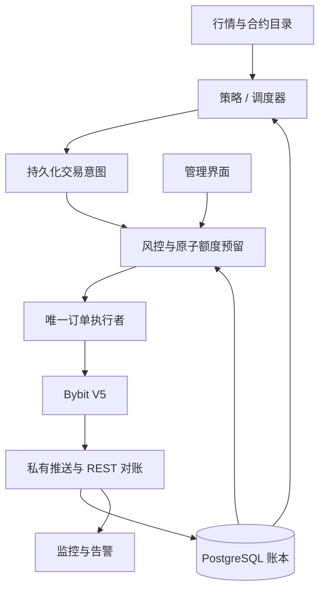

# Bybit 现货与期权自动交易系统需求文档

版本：v0.1 · 首期开发基线  
状态：已完成一轮需求评审；可进入开发拆解，尚不具备实盘上线条件。  
配套文件：[需求自评报告](requirements-review.md)

## 1. 目标与成功标准

为个人用户建立可长期运行在服务器上的交易系统：按照代码规则或定时任务，在 Bybit 执行现货买卖以及期权买入开仓、卖出平仓，并提供风控、账务核对、故障恢复和人工控制。

首期成功标准是：交易行为符合配置、重复信号不导致重复开仓、资金和持仓预留不被重复使用、异常时停止增加风险、恢复后能核对交易事实、每笔交易可解释和追溯。策略盈利不属于系统可靠性验收指标，也不能由接口连通或模拟成交推导。

本文中“必须”为首期强制要求；“建议”为可调整设计；“待确认”为尚未获得用户决定或尚未实测的事项。P0 必须在对应功能实盘启用前完成；P1 可在首期核心闭环稳定后交付，不阻断其他已验收功能。

## 2. 范围与边界

### 2.1 已确认与设计假设

| 项目 | 内容 | 状态 |
|---|---|---|
| 交易场所 | Bybit，用户已有交易 API Key | 用户已确认；权限、有效性及账户类型未验证 |
| 决策来源 | 代码规则或定时策略 | 用户已确认 |
| 期权方向 | 仅买入开仓和卖出平仓 | 用户已确认 |
| 现货方向 | 买入、卖出，默认不借贷 | 沿用已提出架构的首期默认设计 |
| 运行方式 | 服务器常驻，单人管理、低中频 | 规划假设，需结合实际策略负载验证 |
| 账户隔离 | 使用专用交易子账户，仅放分配给 bot 的资金 | 推荐设计；待用户配置 |
| 技术栈 | Python、Bybit V5/pybit、PostgreSQL、Docker Compose | 建议实现基线，可在不改变需求的前提下调整 |

### 2.2 首期包含

- 行情、合约目录、账户、现货库存及期权持仓的读取与同步。
- 参数化规则策略、持久化定时任务、交易意图、独立风控及统一订单执行。
- 有价格边界的限价下单、撤单、超时处理、部分成交和订单有效期管理。
- 现货买卖；单腿期权买入及多头减仓；本地退出规则与到期处理。
- 模拟执行、一个经过能力验证的非实盘交易环境、小额实盘验证流程。
- 简单管理页面、交易审计、告警、备份及恢复操作说明。

### 2.3 首期不包含

- 期权卖出开仓、多腿组合、永续或期货交易、借贷和杠杆现货。
- 自动 Delta 对冲、组合保证金优化、做市或高频低延迟交易。
- AI 自主决策、TradingView/webhook 信号接入、跨交易所交易。
- 自动充值、提现、划转、自动切换账户保证金模式。
- 多用户 SaaS、双活执行、复杂权限体系、完整历史期权回测平台。
- 直接替用户决定交易标的、策略参数或资金限额。

## 3. 用户流程与架构

主要用户为账户所有者，兼任策略配置者和运维人员。系统可以无人值守执行已启用的规则，但上线、策略启用、熔断恢复及资金分配由用户控制。

正常流程：配置策略 → 校验配置 → 同步行情与账户 → 生成交易意图 → 风控检查并预留资金/持仓 → 提交订单 → 跟踪成交 → 更新账本与风险 → 执行退出规则 → 对账与报告。

采用模块化单体，模块边界清晰但首期不要求微服务化。策略不能直接使用交易密钥或调用交易写接口；管理页面提交控制命令，执行仍经过统一校验。Web 服务重启不得自动创建第二个交易执行者。

所有需求编号用于开发任务、测试用例和评审追踪。下面列出的 P0 要求是条件式上线门槛，不表示当前已实现或已测试。

## 4. 功能需求

### 4.1 环境与接入

| 编号 | 优先级 | 需求与约束 |
|---|---|---|
| ENV-01 | P0 | 定义 `paper/demo/testnet/live` 独立环境配置，隔离端点、凭据引用、数据库及日志标识。默认 `paper`。Paper 不装载交易凭据，不发送交易写请求。Demo 与 Testnet 分别配置；部署可只启用已验收的一种非实盘环境。 |
| ENV-02 | P0 | 启动时校验预期 UID/子账户、API 权限、账户模式、允许产品和端点站点。环境或账户身份不匹配、必要权限缺失、已发现非预期负债/空头时，进入只读或暂停状态，不自动修改账户设置。实际能力不足时明确禁用相关产品。 |
| ENV-03 | P0 | 实盘必须同时具备独立的实盘允许配置、完整风控参数、相应阶段验收记录及人工启用操作。区分人工看守的受限实盘验证和正式无人值守运行，按第 8 节分别设置门槛。切换环境不复用任务运行记录或自动恢复实盘发单资格。自动化测试环境必须阻断实盘交易写接口。 |

Bybit 的 Demo 使用独立账户和密钥，且并非支持全部接口；公共行情与私有账户流的端点规则也不同。部署必须按所选环境的官方说明验证，而不能只切换一个 `testnet` 布尔值。[Demo 官方说明](https://bybit-exchange.github.io/docs/v5/demo)

### 4.2 行情与交易品种

| 编号 | 优先级 | 需求与约束 |
|---|---|---|
| MKT-01 | P0 | 动态获取并缓存交易规格：产品类别、symbol、标的、报价币、结算币、价格步长、数量步长、最小订单限制；期权另保存方向、行权价、到期时间及状态。处理分页、更新和退市。只允许白名单内、当前可交易的品种开仓。字段缺失或解析失败时拒绝相关交易。 |
| MKT-02 | P0 | 保存行情来源时间、接收时间与数据有效性。使用买卖报价和所需深度判断价差及可执行价格；标记价仅用于指定估值用途。盘口快照/增量出现断档时重建，重建前不得使用不完整数据批准订单。数据过期或交叉报价等异常时暂停相关开仓。 |
| MKT-03 | P0 | 订阅重连后重新验证行情及账户快照，不能把“连接成功”视为“数据已恢复”。期权开仓所需的 IV、Delta 等缺失、过期或单位未经验证时，相关规则不执行。记录策略决策使用的数据快照引用。 |

交易规则随合约变化，应由合约规格接口驱动；期权目录可能包含未上市或交割中的合约，不能把所有返回结果当作可交易集合。[合约规格接口](https://bybit-exchange.github.io/docs/v5/market/instrument)

### 4.3 策略与调度

| 编号 | 优先级 | 需求与约束 |
|---|---|---|
| STR-01 | P0 | 策略仅生成标准交易意图：策略与配置版本、唯一信号编号、账户/环境、产品与合约、开平仓目的、方向、数量及其单位、价格边界、有效期、退出规则引用。相同输入与版本产生可解释的确定性结果。 |
| STR-02 | P0 | 定时任务持久化调度时区和计划时刻。信号去重键包含策略实例、规则编号和计划时刻/事件编号；任务重试与进程重启不重复执行。首期默认跳过已错过时刻，禁止停机后集中补买；过期信号被拒绝，冷却时间持久化。 |
| STR-03 | P0 | 提供定时固定预算现货买入、参数化单腿期权买入的参考策略，以及持有期限/收益阈值/到期前退出规则。所有参数由配置给出，模板默认禁用。期权按方向、到期范围、行权价或 Delta 规则、流动性筛选；无符合条件合约时跳过；候选排序和并列决胜规则固定并记录。 |
| STR-04 | P0 | 配置变更生成不可变版本，校验后原子生效。正在处理的订单保留原决策版本；收紧限额时重新评估未完成开仓单和预留，超限则暂停新增风险并撤销相关 bot 开仓单，保留撤单竞态中的实际成交，不默认撤销减仓单。策略停用停止新开仓并撤销该策略开仓挂单，已有仓位退出管理保持运行。 |
| STR-05 | P0 | Paper 使用可重复的模拟成交模型，报告明确标记模拟。开仓不得因标记价到达就自动全额成交；用有效买卖报价、可见深度、配置费用及下文撮合规则计算。支持部分成交、取消及结果未知等故障注入；故障实验报告与策略表现报告分别标识。 |

Paper 最小模型：以意图接收之后的下一份有效盘口为最早成交时点；买限价触及卖盘、卖限价触及买盘时，按价格优先遍历限价以内的可见深度。相同快照的可用深度在所有模拟订单间共享扣减，处理顺序固定。未触价挂单保留，不推测队列位置或未显示流动性；手续费使用明确版本的保守费率。模拟余额由独立初始资金配置提供。该模型不刻画真实排队、延迟及市场冲击，结果不作为实际可成交性证明。

### 4.4 独立风控

| 编号 | 优先级 | 需求与约束 |
|---|---|---|
| RSK-01 | P0 | 统一检查白名单、单笔额度、按策略及账户的现货敞口、期权权利金预算、最大订单数量、费用余量、价格偏离、价差、信号时效及行情/账户状态。每次检查输出批准或拒绝、原因和使用的配置版本。缺少必填参数时拒绝实盘启用。 |
| RSK-02 | P0 | 资金与可平仓数量必须在同一持久化事务中校验并预留；计入有效挂单、部分成交剩余量及结果未知的请求。多个策略共享账户级预算。支出必须由对应币种自有、未占用现金覆盖，不能以抵押品折算额度、期权浮盈或可借额度替代。不得重复扣除交易所冻结额与对应本地预留，也不得漏算尚未反映在交易所快照中的预留。持续检查负债，新增负债触发账户暂停和告警。 |
| RSK-03 | P0 | 触发日亏损/回撤上限、行情或账户失效、未知订单、严重对账差异、执行权丢失等事件时暂停新增风险。账户不可信、未知执行结果和资金差异默认暂停整个账户。纯单品种行情异常可以只暂停相关品种，但不能沿用其旧估值证明账户安全。 |
| RSK-04 | P0 | 减仓路径与开仓路径分别判定：达到开仓预算/亏损阈值不应单独阻止可信的减仓，但减仓仍必须满足身份、执行权、可信持仓、数量预留、价格边界和审计条件。数据库不可写或持仓不可信时不得自动发新的买卖单，转为告警与人工处置。 |
| RSK-05 | P0 | 所有开仓检查现货敞口及每标的双侧 Delta 约束；期权另检查权利金及费用预算、到期集中度和距到期时间。账户 Delta 包含全部已识别账户现货/期权及已确认外部仓位，按标的分别归一化；候选订单及未完成挂单的可能成交范围按下文计算。策略归属仅用于策略子额度。Gamma/Vega/Theta 首期记录展示，复杂压力测试为 P1。 |

“增加风险”采用首期可执行定义：新的买入意图、增加挂单数量或提高最大支出均须开仓授权；卖出已持有资产作为减仓请求单独校验，不承诺它降低所有 Greeks 或所有市场情景下的组合风险。已有买入挂单在暂停时也需要撤单处理。

Delta 风控单位为每个标的的基础币数量，设该标的绝对限额为 `L`。以可信实际持仓计算 `D0`，将候选订单和全部未完成订单的剩余量转换为当前行情下完全成交的 Delta 变化 `d_i`；检查区间 `D_min = D0 + sum(min(0, d_i))`、`D_max = D0 + sum(max(0, d_i))` 均落在 `[-L, L]` 内。不能依靠两张方向相反的挂单同时成交来抵消风险；无法量化的未知敞口直接暂停开仓。此区间保守覆盖部分成交组合，不代表未来价格变化下的 Delta 保证。期权数量、报价及 Greeks 单位映射必须用样例验证。减仓使 Delta 更偏离时展示影响、告警并暂停新增风险，按预先授权的退出规则执行，首期不自动买入其他产品对冲。

### 4.5 订单执行与防重复

| 编号 | 优先级 | 需求与约束 |
|---|---|---|
| EXE-01 | P0 | 订单意图、资金预留和待发送记录先持久化，再调用 Bybit。每次物理订单有唯一 `orderLinkId`，与业务意图关联；字段符合交易所限制。订单已被受理不代表成交。[下单语义](https://bybit-exchange.github.io/docs/v5/order/create-order) |
| EXE-02 | P0 | 网络超时、发送期间崩溃或响应无法判定时标记 `UNKNOWN`，保留预留并暂停账户新增风险。根据订单与成交查询、推送及重叠时间窗持续核实；一次未查询到不能判定失败。只有可关联的交易所订单事实、排除既有受理/成交的明确拒绝，或可证明发送器从未领取该请求的本地持久化证据，才能消除对应不确定性。重复编号报错或人工确认本身不是未受理证明。无法证明时禁止换编号重发或释放预留。 |
| EXE-03 | P0 | 按实际成交逐笔记账，对重复成交去重；订单终态不被旧事件倒退，晚到的真实成交仍必须入账。部分成交保留剩余预留。撤单受理不等于撤单完成；必须核对最终订单状态和累计成交后，才释放剩余预留。 |
| EXE-04 | P0 | 统一限流、带抖动退避及请求超时。查询可以按策略重试，交易写请求不能通用自动重试。信号有效期只控制新提交；本地订单 TTL 到期只触发撤单，不代表交易所终态。首期追价采用撤单确认后重建，重建为同一意图的子订单，重新检查风险；累计成交、未完成数量和最大支出不能超过原意图边界。 |
| EXE-05 | P0 | 每个账户/环境最多一个具有发单资格的执行者。部署、重启、锁丢失和数据库断连时执行资格失效。新执行者接管前必须确认旧执行者已停止并完成对账；仅数据库锁超时不能作为旧进程已停止的证据。失权时的在途请求作为待核实交易处理。 |

订单的业务状态和同步可信度分别保存。典型业务状态为 `PREPARED → SUBMITTING → ACCEPTED → PARTIALLY_FILLED → FILLED/CANCELED/REJECTED/EXPIRED`，允许跳过未观察到的中间态。`UNKNOWN` 表示结果或同步状态不确定，可与部分成交事实并存；不能用它覆盖已确认的成交数量。

`EXPIRED` 只用于已确认的交易所失效事实，不能因本地计时器到期直接写入。进程离线时本地 TTL 无法保证挂单停止成交。已确认未发送且业务意图已过期的记录可终止并释放预留，但不伪造交易所订单；发送器已经领取而无明确结果的请求不能仅凭未记录响应证明“未发送”。发现仍活动的订单可消除“是否被受理”的未知状态，但预留必须持续到成交或确认终结；人工恢复页面应展示证据及预留处理结果。

### 4.6 现货交易

| 编号 | 优先级 | 需求与约束 |
|---|---|---|
| SPT-01 | P0 | 只使用自有可用资金，现货参数明确 `isLeverage=0`；不调用借贷接口。限价单明确基础币数量，预算按价格上限和费用计算。首期限价执行；后续支持市价时必须另外验收基础币/计价币单位，不能隐式复用数量字段。 |
| SPT-02 | P0 | 维护策略归属库存、账户实际余额、交易所冻结和本地预留。卖出不超过 bot 可管理库存及账户可用余额的较小约束；计入基础币手续费。精度向不扩大支出的方向处理，小于最小下单要求的余额标记为零碎余额，不为清零而加仓。 |

### 4.7 期权交易与到期

| 编号 | 优先级 | 需求与约束 |
|---|---|---|
| OPT-01 | P0 | 仅允许 `BUY_OPEN` 和 `SELL_CLOSE`。平仓发送 `reduceOnly=true`，同时校验可信的多头持仓及尚未完成的平仓预留。交易所不接受必要减仓语义时禁用该功能，不降级为普通卖单。[期权减仓参数](https://bybit-exchange.github.io/docs/v5/order/create-order) |
| OPT-02 | P0 | 平仓授权同时受可信账户多头、bot 已接管数量及当前策略归属数量约束，各层扣除相应待执行、已提交、未知状态平仓单的剩余预留，取最小可用量。对账恢复不等于接管外部仓位。重复信号、撤单竞态和部分成交均不得授权超额卖单。外部改仓时停止自动卖出并对账；跨策略减仓须显式控制命令指定分摊数量。 |
| OPT-03 | P0 | 新开仓满足合约筛选、到期窗口、报价和 Delta 时效、权利金预算；最大权利金及费用必须由对应结算/费用币种的自有未占用现金覆盖。订单以价格限额执行，首期不使用 IV 报价下单。退出规则使用明确的可成交报价估值，设置最大追价次数、退出有效期和价格底线；无报价时不得把退出标为成功。 |
| OPT-04 | P0 | 禁开仓窗口内拒绝买入；相关开仓单的本地 TTL 不得晚于窗口起点，进入窗口撤销仍活动的 bot 买单并核对撤单竞态和晚到成交。到退出时刻尝试减仓。未能撤销/退出时告警且展示余量，不宣称已消除风险。到期持仓通过交割/结算、费用与余额核对终结，不伪造成普通卖出；证据不足时保留待对账状态及预算占用。 |

当前官方说明期权使用全仓或组合保证金模式，不支持逐仓；实际账户模式和可交易合约仍须接入验证。专用子账户是资金范围控制措施。合约结算币种以元数据为准，不能因历史示例出现 USDC 就硬编码。[期权账户要求](https://www.bybit.com/en/help-center/article/How-to-Get-Started-with-Options-Trading-on-Bybit)、[期权介绍](https://www.bybit.com/en/help-center/article/Introduction-to-Bybit-Options)

UTA 在缺少结算币时提交期权买单可能触发自动借贷，因此禁止借贷必须覆盖期权资金检查；`totalAvailableBalance` 等账户保证金额度不能直接视为结算币现金。字段映射需按当前账户模式验证。[UTA 借贷说明](https://www.bybit.com/en/help-center/article/Borrowing-Repayment-UTA)、[钱包余额字段](https://bybit-exchange.github.io/docs/v5/account/wallet-balance)

### 4.8 账本、对账与损益

| 编号 | 优先级 | 需求与约束 |
|---|---|---|
| LED-01 | P0 | 保存交易意图、风险决策、订单、成交、费用、资金流、期权结算和配置历史；业务账本追加事件，纠错使用更正事件。以账户/环境/产品与成交编号构成去重域，费用保留原币种和估值信息。 |
| LED-02 | P0 | 启动、重连及周期性执行账户/挂单/持仓/近期成交对账；记录水位、分页游标和重叠窗口。缺失成交、未知订单和预留差异修复完成前不恢复开仓。交易所事实用于校正实际余额和持仓，本地账本保留策略归属与决策依据。 |
| LED-03 | P0 | 识别非 bot 订单、人工交易、充值、划转与其他账户变化；计入账户总风险但不自动归属某策略。未解释变化暂停账户开仓，人工确认后重建基线。默认不接管或撤销人工订单；导入已有库存必须明确数量、成本来源、归属及审计记录。 |
| LED-04 | P0 | 损益区分交易盈亏、费用、未实现变化、结算和外部资金流；定义统一估值币种、日界线及估值质量。日亏损和回撤按下文口径计算。数据不完整时展示“估值不可用”，不能显示为零风险或用旧净值解除熔断。 |

损益及风险口径：

- 内部时间统一 UTC；调度与报表默认显示 Asia/Shanghai，日界线默认该时区 00:00，可配置但必须版本化。估值币种由用户选择并在实盘前锁定，不能假定所有稳定币恒等于 1。
- 风控 `Equity` 使用唯一、版本化的估值政策：自有净现金按指定现货/汇率源换算，加各期权多头按指定标记价及已验证报价单位计算的价值，并按字段语义扣除尚未计入净现金的负债。日初权益、日损益和历史高点全部使用同一政策。交易所已包含期权价值的 `equity/totalEquity` 仅用于核对，不再叠加期权价值。费用已反映在权益中时不再次扣除。
- 当日资金流调整损益：`PnL_day(t) = Equity(t) - Equity(day_start) - NetExternalFlow(day_start,t)`。净流入为正，净流出为负，按发生时的估值换算。
- 从已确认起点计算资金流调整权益 `AdjustedEquity(t) = Equity(t) - CumulativeNetExternalFlow(t)`，回撤金额为该序列历史高点减当前值。首期强制使用估值币种绝对金额阈值；不把该值直接称为标准化投资收益率。
- 现货按策略/币种、期权按策略/合约分别采用移动加权成本；部分平仓按数量比例结转成本和已分配开仓费用，再计当次平仓费用。不同策略成本不混合；外部导入记录成本来源，未知时不虚构历史已实现收益。到期结算独立记账。
- 多头平仓触发参考有效买一及所需深度、预估费用，单独形成“可成交估值”；不自动替换风控权益序列，不把标记价 PnL 当作可兑现 PnL。任一风控所需估值或汇率过期时停止据此批准新增风险。
- 日界线切换只更新日统计，不自动解除已触发的暂停；回撤高点不因重启或换日重置。
- 日初快照缺失时，只有通过完整账务及对应时点行情重建并验证的基线才可使用；无法重建则暂停开仓，不以当前权益假装当日零亏损。首次接入可经用户明确确认建立独立 `risk_start_at`，首日标记为“不完整交易日”，从该起点执行损失限额；不宣称覆盖接入前损失。重启不得重新建立起点。
- 估值政策、日界线或起始基线变更仅在暂停状态有审计地执行，不得清除既有熔断和回撤历史。恢复前验证新旧口径或建立明确标识的新序列，历史保留。

### 4.9 管理、告警与运行状态

| 编号 | 优先级 | 需求与约束 |
|---|---|---|
| OPS-01 | P0 | 管理页展示环境、账户标识、运行状态、策略版本、余额/库存/持仓、挂单、未知订单、成交费用、数据年龄、对账差异和风控拒绝原因；所有金额带币种、估值带时间。提供 CSV 导出交易审计。 |
| OPS-02 | P0 | 提供暂停新增风险、撤销 bot 开仓单、撤销指定 bot 订单、受限减仓和恢复操作。显示作用范围与执行结果；命令有唯一编号、持久化状态及审计。高影响操作需在产品内明确确认，重复点击不重复生成执行意图。 |
| OPS-03 | P0 | 数据暂时失效等技术暂停须经重新同步及全部检查通过才可解除；亏损熔断、未知订单、外部改仓或恢复演练造成的暂停保持锁定。人工确认不能替代 EXE-02 证据与对账；全部解除条件具备后方可恢复。重启不能解除暂停。 |
| OPS-04 | P0 | 对账户异常、未知订单、对账差异、断流、API 限流/权限失败、退出未完成、到期未结算、磁盘/数据库故障产生告警；告警去重、保留首发与恢复事件。通知失败落库并重试；关键告警超时未送达时暂停新增风险。 |
| OPS-05 | P0 | 外部心跳监控独立于交易服务器，检测进程及整机失联；实施备份与恢复演练、发布回滚及密钥轮换。只把“已提交/已撤销/已成交/仍有剩余仓位”作为真实状态展示，不把关机或撤单等同于平仓。 |

运行状态及动作约束：

| 状态 | 新开仓 | 退出与撤单 | 恢复条件 |
|---|---|---|---|
| STARTING / RECONCILING | 禁止 | 仅可信且可审计的 bot 撤单；买卖等待可信持仓 | 完成身份、订单、成交、持仓与预留核对 |
| RUNNING | 经风控允许 | 经对应校验允许 | 不适用 |
| PAUSED_OPEN | 禁止；撤销 bot 开仓挂单 | 可信且可审计时继续已有仓位退出；记录未撤成功订单 | 满足暂停原因的解除规则 |
| EXITING | 禁止 | 对指定 bot 仓位按边界减仓，跟踪剩余量 | 已确认目标完成，或暂停并等待用户处理 |
| STOPPED | 禁止 | 进程不执行；交易所挂单和仓位可能仍存在 | 重新启动后完整核对，按持久化启用状态决定是否恢复 |

人工关机前应展示仍存在的挂单与仓位。首期退出规则由 bot 本地执行；服务器或网络故障期间无法保证触发和成交。交易所原生止盈止损作为后续独立验收能力，不在首期默认启用，避免与本地平仓预留冲突。

### 4.10 安全要求

| 编号 | 优先级 | 需求与约束 |
|---|---|---|
| SEC-01 | P0 | 密钥仅供交易适配器使用，通过受限配置文件或密钥服务注入；不进 Git、镜像、业务表、URL 或日志。只保留必要的读取/现货/期权交易权限，关闭提现及不需要的划转，绑定固定出口 IP。启动只记录脱敏身份和权限摘要。 |
| SEC-02 | P0 | 管理界面通过私有网络或受控 HTTPS 入口访问，具有身份认证、会话过期及写操作保护；数据库不向公网开放。所有控制动作记录操作者、时间、范围与结果，日志及导出内容脱敏。 |
| SEC-03 | P0 | 依赖版本固定，部署产物带版本号；测试不含真实密钥。轮换密钥时先暂停开仓并核对在途订单，验证新凭据后再恢复；失效或泄露凭据对应的操作流程必须可执行。 |

## 5. 数据与配置约束

### 5.1 主要数据实体

| 实体 | 最小内容 |
|---|---|
| Strategy / ConfigVersion | 策略实例、不可变版本、启用状态、参数、退出规则 |
| ScheduleRun / Signal | 计划时刻、唯一去重键、输入快照、过期时间、处理结果 |
| TradeIntent / RiskDecision | 业务目的、数量/币种、支出边界、风险检查与拒绝原因 |
| Reservation | 资金或持仓数量、关联订单、已消耗及待释放部分、状态 |
| Order / Execution | 业务意图、物理订单及交易所编号、状态、实际成交、手续费 |
| Inventory / Position | 账户实际数量、策略归属、成本及可信状态、期权到期信息 |
| LedgerEvent / CashFlow | 成交、费用、结算、外部资金流、更正记录及幂等标识 |
| ReconciliationRun | 查询范围、水位、差异、修复过程、是否允许恢复 |
| ControlCommand / Alert | 操作或告警编号、原因、执行/送达/确认/恢复状态 |

金额和数量使用 Decimal/数据库 DECIMAL；时间使用带时区的 UTC 时间戳。原始交易所消息可脱敏保留用于诊断，不能以未经去重的原始消息直接重复记账。数据库唯一约束保障信号、物理订单、成交和控制命令的幂等性。

### 5.2 实盘必填配置

以下参数不在文档中代填资金数值。任何缺失、负值、币种不匹配或逻辑矛盾都应被校验拒绝。

| 类别 | 必填内容 |
|---|---|
| 账户 | 环境、预期 UID、站点端点、凭据引用、允许产品与账户模式 |
| 策略 | 标的白名单、触发/调度规则、信号有效期、冷却时间、退出规则 |
| 资金 | 单笔最大支出、账户/策略现货敞口、期权权利金预算、费用余量、最大挂单数 |
| 风险 | 当日最大亏损金额、最大回撤金额、每标的绝对 Delta 限额 L、按标的/到期日的权利金成本上限 |
| 行情 | 最大行情年龄、账户状态校验周期与有效期、最大价差、价格偏离边界 |
| 执行 | 信号有效期、本地订单 TTL、撤单查询时限、重建订单次数、总支出上限、退出价格底线 |
| 期权 | Call/Put 规则、到期区间、行权价/Delta 筛选、禁开仓窗口、退出时刻 |
| 运维 | 告警渠道、通知失败暂停时限、外部心跳、数据保留、备份目标、最大时钟偏差、估值政策及日界线时区 |

不同金额预算的语义必须显示在配置界面：现货敞口按约定估值计算；期权预算按未平仓多头成本加开仓预留计算。经确认的部分/全部平仓，或完成对账的到期终结，按消除的持仓成本释放预算；零支付到期也需要终结证据。仅时间到期、仓位暂时消失或标记价下跌均不释放预算。到期集中度首期定义为同一标的、同一 UTC 到期日的持仓成本加开仓预留，按统一估值币种设置绝对金额上限。日亏损/回撤限制重复买入造成的累计损失。

## 6. 非功能需求与首期容量

以下数值是拟定工程验收基线，不是当前实测结果。可在容量测试后变更，变更必须记录依据。

| 编号 | 优先级 | 拟定指标与边界 |
|---|---|---|
| NFR-01 | P0 | 首期容量：1 个账户、最多 5 个策略实例、10 个现货交易对、200 个候选期权合约；策略合计提交意图不超过 1 次/秒，低于交易所实际限额运行。超出范围必须另做容量及订阅验证。候选目录、报价刷新与深度订阅分层，不要求全市场逐笔保存。 |
| NFR-02 | P0 | 在指定容量、4 vCPU/8GB 参考环境、数据库正常且不含外部网络/API等待时，意图校验与持久化预留处理 P95 ≤ 500ms。实时行情过期判断按配置执行；不承诺交易所受理或成交时延。 |
| NFR-03 | P0 | 建议周期完整对账 60 秒一次，异常立即触发补查；具体账户有效期不得短于正常校验周期且必须适配限流。关键告警从本地检测到首次尝试发送 ≤ 10 秒；外部监控在连续 3 次、间隔 30 秒心跳缺失后告警，无法联系服务器时不得宣称已撤单。 |
| NFR-04 | P0 | 每日加密异机备份，备份 RPO 目标 ≤ 24 小时；在数据源可用时，恢复至只读可对账服务 RTO 目标 ≤ 2 小时。恢复交易资格另行验证。缺失记录无法回填或确认时持续暂停，不能以 RTO 到期为理由跳过对账。 |
| NFR-05 | P0 | 交易、配置、风控与审计记录建议保留至少 1 年；原始行情短期保留 7 天，可按空间调整；按策略决策保存的必要行情快照随审计记录保留。磁盘容量设告警及暂停阈值。达到容量边界时停止新增风险，不静默丢弃账务记录。 |
| NFR-06 | P0 | 服务器启用时间同步，监测与交易所时间的偏差；最大允许偏差必须配置并与请求有效窗口匹配。超限或时钟跳变时暂停新开仓并告警，不通过无限增大请求窗口掩盖问题。超时和退避采用单调时钟；调度使用持久化 UTC 计划标识避免时钟回拨重复执行。 |

单服务器首期不承诺无中断运行。数据库故障时暂停自动交易；任何备用方案上线前必须证明不会出现两个执行者。REST/WS 重连需要退避，交易接口限额以账户及响应头为准，不能把文档中的通用数字当成所有账户的固定能力。[限流规则](https://bybit-exchange.github.io/docs/v5/rate-limit)

## 7. 验收用例与证据

下面全部用例都必须有输入、操作过程、预期结果、实际结果、日志/数据库证据和软件版本。本文定义验收标准，不代表已执行测试。

| 用例 | 覆盖需求 | 场景与通过条件 |
|---|---|---|
| AC-01 | ENV-01、ENV-02、ENV-03 | 错配环境端点、UID、权限或实盘开关；启动拒绝发单。Paper 不加载交易凭据，测试网络策略阻断实盘交易写请求；不会自动切换账户模式。 |
| AC-02 | MKT-01、SPT-01 | 修改价格/数量步长、最小金额及合约状态；新订单采用更新规则或被拒绝，不扩大预算，不对非交易状态合约开仓。现货不借贷。 |
| AC-03 | MKT-02、MKT-03、RSK-03 | 断开行情、制造增量缺口或过期 Delta；暂停相关开仓，重建后才恢复。仅重连成功、旧估值或异常报价都不能通过校验。 |
| AC-04 | STR-01、STR-02 | 同一计划时刻重复投递 100 次，包含重启与时区跨日；至多一个有效业务意图，已过期任务不集中补买。 |
| AC-05 | STR-03、OPT-03 | 固定行情回放得到同一合约及同一理由；无符合条件合约时不下单。止盈/止损/到期前退出按指定报价和费用口径触发。 |
| AC-06 | STR-04、RSK-01 | 修改配置、收紧限额、停用策略、缺失必填数值；新意图使用新版本，历史可追溯。旧开仓挂单被重新评估并按要求撤销，撤单前成交正常入账；未完整配置不能实盘启用。 |
| AC-07 | RSK-02、SPT-02 | 两个策略同时申请同一余额或库存，含已冻结资金及本地预留；授权总量不超可用额度，无重复扣除或遗漏。基础币手续费及零碎余额正确处理。 |
| AC-08 | EXE-01、EXE-02 | 交易所接受订单但响应丢失；保持 UNKNOWN 和预留，查到结果后合并同一订单。查询暂时查不到或人工点击恢复不能释放预留。分别验证明确拒绝、可信未发送证据、活动订单及最终成交的处理。 |
| AC-09 | EXE-01、EXE-02、LED-02 | 在持久化前、持久化后发送前、发送后未保存响应、部分成交后分别终止进程；恢复先对账，不重复开仓、不漏记成交，未知结果保持暂停。 |
| AC-10 | EXE-03、LED-01 | 重复及乱序推送、撤单与成交竞态、晚到成交；不重复记账、不错误回退终态，最终累计成交及预留与交易所一致。 |
| AC-11 | EXE-04 | 模拟限流、权限错误、信号过期、本地 TTL 到期但交易所订单仍活动、停机错过 TTL；退避不形成请求风暴，写请求不盲重试，未确认终态不释放预留、不重建，子订单总量不突破意图上限。 |
| AC-12 | EXE-05、RSK-03 | 同时启动两个实例；只有一个有发单资格。断开执行者数据库连接，新实例不得仅因锁释放就接管；确认旧实例停止、核对在途请求后方可恢复。 |
| AC-13 | OPT-01、OPT-02 | 两个平仓信号竞争同一多头仓位，叠加部分成交、未知卖单和撤单竞态；新卖单授权不超账户/bot/策略各层可平量。账户持仓大于 bot 归属时不卖出外部仓位；平仓均减仓限定，无该能力时禁用。 |
| AC-14 | RSK-05、OPT-03 | 验证多标的单位、大负 Delta、已确认外部库存、相反挂单只有一侧成交，以及现货新单改变账户 Delta；可能区间任一端越界则拒绝开仓。权利金、到期集中度、价格边界超限同样拒绝。 |
| AC-15 | OPT-04、LED-01 | 禁开仓窗口前挂买单，窗口开始撤单但发生晚到成交；跟踪真实余量。分别验证价外零支付到期及价内现金结算，证据完整才释放成本预算；待结算不释放，事件重放不重复记账或重复释放。 |
| AC-16 | LED-02、LED-03、OPT-02 | 在交易所手动下单/改仓或划转资金；识别外部变化，暂停开仓，不自动撤销人工单，旧持仓不能继续授权期权卖出；确认后有审计地重建基线。 |
| AC-17 | LED-04、RSK-03 | 注资、提款、跨币费用、跨日、标记价与买价明显不同；保持单一权益政策，费用/期权价值不双算。日初基线缺失时拒绝开仓，首次接入显式初始化并标记不完整日；重启不重置高点，失效估值不解除暂停。 |
| AC-18 | RSK-04、OPS-02、OPS-03 | 触发亏损阈值后停止开仓并撤销 bot 买单；可信减仓可继续。数据库不可写或持仓不可信时不发新买卖单。重启/换日不解除锁定，人工恢复前必须对账通过。 |
| AC-19 | OPS-01、OPS-02 | 页面显示环境、币种、数据时效和未完成状态；重复点击减仓/撤单只产生一个控制命令；导出能追溯信号、配置、风险、订单、费用与成交。 |
| AC-20 | OPS-04、OPS-05、NFR-03 | 模拟断流、未知订单、退出未完成、通知失败及整机失联；告警含原因和剩余仓位，按指标尝试送达，通知持续失败暂停开仓，外部监控独立报警。 |
| AC-21 | SEC-01、SEC-02、SEC-03 | 扫描代码/日志/镜像/导出无明文密钥；未登录或过期会话不能控制交易；数据库无公网入口；凭据轮换保持在途订单可追踪，自动化测试无真实凭据。 |
| AC-22 | NFR-01、NFR-02、NFR-05 | 在指定容量下记录延迟分布、CPU/内存、订阅量和磁盘增长；满足性能基线。模拟磁盘不足，触发暂停且账务记录无静默丢失。 |
| AC-23 | OPS-05、NFR-04、LED-02 | 从备份恢复，回填备份后交易并核对余额/持仓/预留；在目标内恢复只读服务；未能确认历史完整性时不恢复交易资格。 |
| AC-24 | ENV-02、OPT-01、OPT-03、OPT-04 | 在所选非实盘环境验证期权权限、减仓参数、成交/撤单与结算能力；不支持项记录为未通过，不能以现货成功替代期权验收。 |
| AC-25 | EXE-03、SPT-02、OPT-02、LED-04 | 同合约两策略分批买入再部分平仓，费用币种不同；逐策略成本、可平数量、预算释放正确。核对权利金支付→持仓估值→平仓/到期现金全过程，无重复资产估值。 |
| AC-26 | NFR-06、STR-02 | 模拟系统时钟前跳、回拨和超出允许偏差；暂停新开仓，调度不重复补做，超时/退避时长不被墙上时钟跳变破坏，时间恢复仍须满足对账和暂停解除条件。 |
| AC-27 | RSK-02、OPT-03、ENV-02 | 账户抵押品充足但结算币现金不足，期权买单被拒绝；已有预留与费用余量正确扣算。运行中注入新增负债，暂停并告警，不自动借贷或划转解决。 |
| AC-28 | STR-05 | 固定盘口、费用和事件顺序下模拟结果可重复；未触价不成交，深度不足部分成交，同快照深度不被多个订单重复使用。报告标记模拟及模型限制，不将故障实验当收益记录。 |

执行级别：AC-04～AC-19 中可故障注入的场景先通过模拟适配器/集成测试完成，再在非实盘环境覆盖正常链路。非实盘无法产生的到期结算等场景用固定真实结构样例验证解析与记账，仍保留实盘能力待验证标记；不能把模拟证据当成实际账户功能证据。

小额实盘阶段只使用经用户确认的资金限额和策略，确认真实费用、持仓、减仓及对账；采用至少 72 小时连续观察作为建议基线，同时必须覆盖所启用功能的关键场景。经过一定时长本身不能替代故障测试或到期结算验收。

## 8. 实施阶段与交付物

| 阶段 | 交付物 | 退出条件 |
|---|---|---|
| M0：开发基线 | 本需求、评审报告、配置模式、数据模型与测试计划 | 范围无关键歧义；必填参数与待确认项清晰 |
| M1：只读接入 | 合约目录、账户与行情同步、账本骨架、身份及权限报告 | AC-01～AC-03 的只读部分通过；账户事实可核对 |
| M2：模拟闭环 | 规则策略、风控、预留、订单状态与恢复逻辑、故障注入 | 核心不变量及 AC-04～AC-19 可模拟部分通过 |
| M3：非实盘联调 | 所选 Demo/Testnet 适配、管理页面、告警、部署和恢复说明 | 适用 P0 用例通过；不支持能力明确隔离；有备份恢复证据 |
| M4a：受限实盘验证 | 专用账户/限额/人工看守与启用，小额验证报告 | 进入前完成可在 M3 验证的 P0 项及账户只读检查；进入后取得首笔实际成交、减仓、费用和对账证据 |
| M4b：正式无人值守 | 已验证功能白名单、运行报告、告警和人工处置机制 | 所启用功能实盘证据完整，无未解释差异；到期终结仍未验证时不开放无人值守期权持仓运行 |
| M5：后续扩展 | Gamma/Vega/Theta 深入分析、历史研究、更多策略 | 新需求另行定义，不自动开放期权卖方或多腿能力 |

M0～M3 可在具体投资金额尚未确定时继续开发。M4a 前关闭资金配置、身份权限、模拟及非实盘流程、告警等前置阻断项；只能通过实盘获取的证据在 M4a 人工看守下取得，不反过来作为首笔验证订单的前置条件。若非实盘缺少某接口能力，只有接口契约/模拟故障测试、官方支持说明和只读检查均通过，且用户明确接受限定功能与金额的人工验证，才可纳入 M4a；其实际能力在验证前仍标记未通过。M4b 前关闭全部所启用功能的阻断项。每阶段交付运行说明、无密钥配置示例、版本信息和验收证据。当前仅交付文档，没有创建账户、部署服务或执行任何交易。

## 9. 待确认事项与上线门槛

| 编号 | 待确认事项 | 谁来关闭 / 所需证据 | 阻断范围 |
|---|---|---|---|
| TBD-01 | 首批现货交易对、期权标的及可用站点 | 用户选择；只读能力报告 | 具体策略实盘启用 |
| TBD-02 | 第一条策略的时间/条件、仓位规则、退出规则和期权选择规则 | 用户确认参数，固定行情样例验收 | 策略实盘启用；不阻断引擎开发 |
| TBD-03 | 专用资金、单笔/累计额度、日亏损/回撤、Delta 与到期集中度限额 | 用户确认带币种/单位的配置 | 所有实盘交易 |
| TBD-04 | 子账户、UID、账户模式、期权权限及历史库存归属 | 用户配置；只读校验及必要的非实盘验证 | 对应产品的实盘交易 |
| TBD-05 | 服务器地域、固定 IP、站点域名、API 可达性 | 按账户适用条件选择并验证，不能仅根据聊天时区推断 | 部署及账户接入 |
| TBD-06 | Demo 或 Testnet 选择、期权减仓/结算能力、数量及 Greeks 单位 | 适配器测试与实际环境证据 | 对应功能的实盘启用 |
| TBD-07 | 告警渠道、外部监控、备份位置、故障人工处置方式 | 用户选择；发送/失联/恢复演练 | 无人值守实盘运行 |
| TBD-08 | 估值币种、日界线、初始权益和成本基线、金额容差 | 用户确认口径；固定样例对账 | 亏损风控及实盘启用 |

实盘启用必须具备：版本化配置、正确环境与账户、对应 M4a/M4b 阶段的 P0 验收证据、无未解释的账务差异、可信的退出路径、可用告警和恢复记录，以及账户所有者的启用操作。文档评审通过不替代这些条件。

## 10. 已知边界与依赖

- 交易所响应、行情连续性、真实成交和退出价格不由 bot 保证。系统能保证的要求是采取规定动作、限制请求、保留证据和展示未完成状态。
- 单台服务器或本地退出逻辑失效期间，退出规则可能无法执行。是否引入交易所原生保护订单，需要另行核对产品支持与并发平仓语义。
- 账户外人工操作可能发生在两次同步之间；专用账户、期权交易所减仓限制和事后对账共同降低影响，不能宣称本地检查可以消除所有外部竞态。
- 官方接口与账户可用产品可能变化。固定 SDK 版本，保留适配层，升级前重复运行接口契约测试；关键能力变化时默认禁用相关交易路径。
- 备份存在时间窗口；灾难恢复后若交易所历史不足或策略归属无法可靠恢复，必须保持暂停，由人工核对。不能以估算重建替代确认。

## 11. 参考依据

业务范围来自本次对话。交易所事实基于撰写时核对的官方资料；具体账户未实测。以下资料用于约束适配器，本文的模块划分、风控机制、容量和验收指标属于工程设计要求。

- [Bybit V5 接入与站点说明](https://bybit-exchange.github.io/docs/v5/guide)：认证、时间同步和地区端点。服务可用性须按账户及服务器实际验证。
- [订单推送](https://bybit-exchange.github.io/docs/v5/websocket/private/order)、[成交推送](https://bybit-exchange.github.io/docs/v5/websocket/private/execution)：订单与成交事件结构及重复消息处理依据。
- [API Key 信息](https://bybit-exchange.github.io/docs/v5/user/apikey-info)：身份、权限和 IP 绑定检查。
- [期权行情](https://bybit-exchange.github.io/docs/v5/market/tickers)、[账户 Greeks](https://bybit-exchange.github.io/docs/v5/account/coin-greeks)：行情与风险数据来源，单位和时效须验证。
- [官方 Python SDK pybit](https://github.com/bybit-exchange/pybit)：建议的 HTTP/WebSocket 接入依赖。

## 12. 版本记录

| 版本 | 内容 |
|---|---|
| v0.1 | 将架构转化为范围、强制需求、状态规则、验收用例、阶段交付和实盘阻断项；吸收一轮独立审查，具体发现与修订记录见配套自评报告。 |
