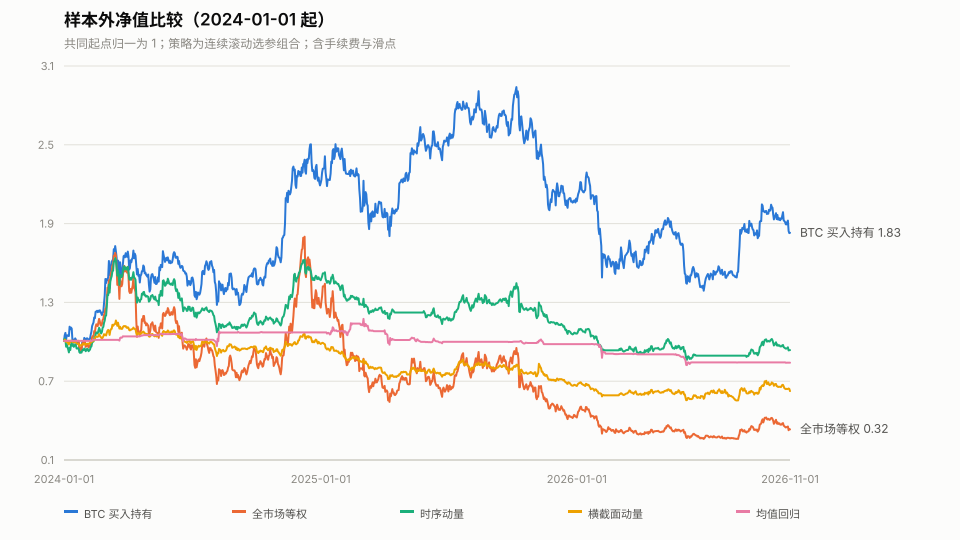

# Bybit 现货与期权策略研究

研究日期：2026-11-02。现货数据快照：2026-11-01 UTC。

**本轮没有找到经过验证的“稳定快速盈利”策略。** 日线时序动量、横截面动量、
短期均值回归都未达到风险与稳健性门槛。36 组小时均值回归参数全部为负夏普。
期权尚缺足够的历史可执行报价，因此本轮不报告期权收益。

这些是对具体规则和这段数据的检验，不能推出所有现货或期权方法都无效。

## 数据与检验口径

| 项目 | 本轮使用的数据与规则 |
| --- | --- |
| 来源 | Bybit V5 公开只读行情接口，不使用交易密钥 |
| 日线输入 | 384 对、386,018 根；输入 sha256 `90a1198545f5a2e8bbe673d4d2302ac3af204b7ea24e5e8942ee78fc3e7ee748` |
| 基础标的池 | 当前存续 USDT 对中，首根日线不晚于 2024-01-01、历史至少 365 根者，共 157 对 |
| 每日可交易资格 | 连续 365 根、前 30 日平均成交额 ≥ 100 万 USDT、20 日年化波动 > 1%；每日最多 121 对 |
| 日线范围 | 2021-07-05 至 2026-11-01 开盘，1,946 个时间点 |
| 固定参数保留样本 OOS | 2024-01-01 至 2026-11-01 开盘，共 1,035 个收益区间 |
| 连续滚动样本 WF | 2023-07-06 至 2026-11-01 开盘，共 1,214 个区间、7 个窗口 |
| 小时输入 | 当时成交额快照选出的 40 对，共同时间轴 24,857 个小时点；2024-01-01 至 2026-11-01 16:00 UTC |
| 成本 | taker 0.10%/边，滑点 0.05%/边，合计一次买卖约 0.30% |

157 是基础标的池数量，不是每天都满足流动性要求的数量。已验证日线 OHLC 范围、
非负量额、有限数值、UTC 对齐和重复时间戳。基础池只有一处缺口：GRAMUSDT 在
2026-06-16 与 2026-06-22 之间缺五根日线。小时输入也做价格、量额、时间戳校验。

执行模型明确跟踪现金和数量：t−1 收盘产生信号，t 开盘按目标权重成交，成本按实际
买卖额扣除。目标按成本后净值计算。缺行情可沿用最后收盘估值，但不能按旧价格成交；
最终仍持仓而无真实报价时直接报错。训练段允许持仓估值，滚动应用组合跨窗口连续持有，
只对实际成交和最终卖出计费。

样本内用夏普选参，之后固定参数运行保留样本。滚动检验每 180 天用前 730 天重新选参，
训练终值比应用开盘早一天；不足 180 天的最后一段也纳入。每族固定参数和滚动使用同一个
完整网格。完整定义、审计修订见 [protocol.md](protocol.md)。

## 日线结果

固定参数表的年化、夏普和回撤都来自同一个 OOS 区间，已扣基准成本。

| 模型 | 样本内选定参数 | OOS 年化 | OOS 夏普 | OOS 最大回撤 | 网格 OOS 正夏普比例 |
| --- | --- | --- | --- | --- | --- |
| BTC 买入持有 | 无选参 | +23.7% | 0.69 | −53.0% | — |
| ETH 买入持有 | 无选参 | −0.5% | 0.32 | −67.6% | — |
| 基础池等权 | 每 30 日再平衡 | −32.9% | −0.18 | −86.1% | — |
| 时序动量 | 回看 180 日、20 日再平衡、目标波动 50%、无市场过滤 | −15.9% | −0.20 | −67.5% | 10/84，11.9% |
| 横截面动量 | 回看 30 日、前 10 名、20 日再平衡、目标波动 30% | −8.6% | −0.28 | −43.7% | 0/48，0% |
| 均值回归 | 回看 10 日、z ≤ −2、持有 5 日，每币 5% | +5.0% | 0.49 | −11.8% | 20/27，74.1% |

BTC 是表中这段保留样本表现最强的基准，但最大回撤约一半。
按日线开盘区间归属自然年，BTC 2024 年 +121.0%、2025 年 −6.3%、2026 年截至
11 月 1 日 −11.7%；不能把 +23.7% 的年化称为稳定收益。

连续滚动结果如下，起点比固定 OOS 早半年，所以分别列出，不把两列当作同区间比较：

| 策略族 | WF 年化 | WF 夏普 | WF 最大回撤 | WF 累计收益 | 判定 |
| --- | --- | --- | --- | --- | --- |
| 时序动量 | +7.5% | 0.39 | −47.7% | +27.0% | 未通过 |
| 横截面动量 | −7.8% | −0.21 | −53.0% | −23.6% | 未通过 |
| 均值回归 | −5.1% | −0.38 | −30.3% | −15.9% | 未通过 |

门槛包括：滚动夏普 ≥ 0.8、滚动和固定 OOS 收益为正、网格正夏普比例 ≥ 60%、
滚动回撤 ≤ 30%，并检查各年风险。三族各有指标不达标。原方案要求的完整 2022 熊市
检验也**未完成**：365 根预热使策略在 2022 年前半段没有交易资格，不能将持币期当作
完整风险验证。JSON 中对此明确保留未验证状态。

均值回归在固定参数下最接近继续观察的条件，但滚动重选后表现明显变差。
这说明本轮“选参规则 + 信号”的组合缺乏稳定性，不能据此断言换一种选参就能盈利。
固定参数 OOS 本身也没有显著正收益证据。

## 成本与统计不确定性

以下保持样本内选出的参数不变，比较 OOS 年化（括号为夏普）。

| 成本/边 | 时序动量 | 横截面动量 | 均值回归 |
| --- | --- | --- | --- |
| 0 | −14.5%（−0.16） | −7.3%（−0.22） | +5.9%（0.56） |
| 0.15% | −15.9%（−0.20） | −8.6%（−0.28） | +5.0%（0.49） |
| 0.30% | −17.2%（−0.24） | −9.9%（−0.35） | +4.1%（0.41） |

两类动量规则在零成本下也亏损，因此手续费不能解释全部失效。
均值回归平均市场暴露只有约 4.1%，5.0% 年化也没有达到“快速盈利”。

20 日循环块 bootstrap 的 OOS 年化**算术平均收益** 95% 区间分别为：
时序动量 [−58.4%, +45.9%]，横截面 [−33.2%, +21.1%]，均值回归 [−3.4%, +13.4%]。
三者都跨过零。这是单一路径的重采样诊断，不能保证未来落在区间内。

样本内 Deflated Sharpe 诊断分别为 0.718、0.479、0.704；它们不是盈利概率，
也没有涵盖整次研究的全部选择。网格尝试高度相关，且滚动重选增加了尝试次数。
均值回归样本内收益分布偏度约 16.3、峰度约 347，少数跳涨对统计量的影响很大。

## 小时级探索

本轮只探索了 40 对上的小时均值回归：回看 6/12/24/48 小时，z 阈值 1.5/2/2.5，
持有 6/12/24 小时，共 36 组。每币 5%、最多 10 币；按 8,760 根/年年化。

| 对象 | 年化 | 夏普 | 最大回撤 | 双边名义换手/年 |
| --- | --- | --- | --- | --- |
| 同期 BTC 买入持有 | +23.7% | 0.69 | −53.7% | 0.7 |
| 36 组中最高夏普的参数 | −5.6% | −0.13 | −27.7% | 139.8 |
| 全部参数分布 | 全部为负收益 | 中位 −0.84，最高 −0.13 | — | — |

最高夏普参数为回看 6 小时、z ≤ −2、持有 24 小时。
它是事后挑选的描述，没有独立保留样本；即使如此仍亏损。
当前成交额选择 40 对含事后筛选和幸存者偏差，不能解释为整个市场的无偏估计。
这项结果否定了本轮这些参数足以覆盖成本的假设，不能否定所有短线、做市或执行方法。

## 净值图与原始产物



图上五条线按共同日期对齐并从 1 归一。策略为从 2023 年启动的连续滚动组合在
2024 年以后的截面，基准为固定 OOS。图用于比较共同区间的曲线形态，完整 WF
指标仍按自己的起止时间计算。图中不是从 2024 年重新选参或重新启动策略。

- [逐日曲线数值](results/equity_curves.csv)
- [日线结果、网格与逐窗参数](results/results.json)
- [小时结果与所有参数](results/intraday_results.json)
- [输入文件清单与 SHA-256](results/data_manifest.json)

## 期权：能验证到什么

期权本轮只有数据和成本可行性核验，没有收益回测。

**历史波动率 HV 有数据，但它不是市场隐含波动率 IV。**
`/v5/market/historical-volatility` 默认报价币 USD 的抽样请求为空；显式加上
`quoteCoin=USDT` 后，BTC/ETH 有记录。记录直接是 `time/value/period` 对象数组。
它按小时提供标的历史波动率，文档查询范围最近两年、单次不超过 30 天。
用它代入期权定价模型只能得到理论价格，不能当作历史市场权利金。

`mark-price-kline` 文档支持 option，但标记价没有成交保证。
已挂牌合约可取得一些历史，例如抽样老合约取得 73 根日线；多个已到期合约的
mark-kline 请求报 `PARAMS_ERROR`，而交割价接口仍能返回结算记录。
这些样本显示历史覆盖问题，不能推出所有到期期权均不可查询。
当前 ticker 有买卖价、IV 和 Greeks，recent-trade 只有近期成交；本轮没有取得覆盖
到期合约、买卖价、规模与历史 IV 的完整数据集，因此无法可信地检验期权成交收益。

普通费率下，期权 taker 交易费为：

`min(指数价格 × 0.0003, 成交权利金单价 × 0.07) × 标的数量`

低价期权单次费用可能达到权利金的 7%。BTC/ETH 还有适用时的交割费和价内价值上限；
日到期期权、未行权期权有豁免。只比较理论方向收益会漏掉价差、交易费、交割费与到期损耗。

抽样 BTC/ETH 的最低数量分别为 0.01 BTC、0.1 ETH，**这不是最低现金投入**。
多头支付的是权利金乘数量再加费用；某些便宜合约可能在 5.55 USDT 内。
抽样一张 ETH 期权最少约 20 USDT，不能推广成“小账户买不了任何期权”。
本轮也没有证据说明廉价期权具备正期望或适合该账户。

## 5.55 USDT 账户的可执行性

研究使用任意可分割数量，未模拟历史最小订单和精度，因此不是该账户的可成交组合。
当前 BTCUSDT、ETHUSDT、SOLUSDT 的元数据均显示 `minOrderAmt=5 USDT`。
一笔 5 USDT 订单约占 5.55 USDT 的 90.1%。

均值回归每币 5% 的目标在该余额下只有 0.2775 USDT，远低于这些币对的最低订单。
动量规则的 30% 单币目标上限也只有 1.665 USDT。
若只按 5% 仓位与 5 USDT 最低订单计算，至少需要约 100 USDT 才能生成一笔入场，
这还未解决精度、部分平仓、费用缓冲与最低成交量问题，也不是建议增加资金。

因此本轮没有把任何规则接入自动下单。NAS 保持 paper、策略禁用和暂停状态；
本研究没有解除实盘门禁、使用交易密钥或提交交易订单。

## 可复现方式与限制

验证结果：17 项研究记账、时间切分、分页和响应解析测试通过；现有仓库 358 项
回归测试通过；管理页面 5 项测试通过；`ruff` 全仓约定范围检查通过。
图表已渲染检查，并附逐日数据表。测试不含真实交易密钥，也未调用交易写接口。

在仓库根目录使用项目的 Python 3.12 虚拟环境。原始行情保留本地，未放入 Git；
输入 SHA-256 可核对同一快照。重新从交易所抓取会得到新的快照，不能保证逐字节一致。
抓取脚本会写 `FETCHED_AT.txt`，但本轮早先抓取异常退出，没有生成该文件，
因此本报告只声称快照抓取日期，不给出虚构的完成时刻。

```bash
.venv/bin/python research/test_backtest.py
```

```bash
.venv/bin/python research/run_research.py --data research/data --out research/results
```

```bash
.venv/bin/python research/intraday_study.py --data research/data/1h --out research/results
```

```bash
.venv/bin/python research/make_chart.py
```

抓取需要可达 Bybit 的网络，且只读公开接口。完整参数见脚本 `--help`；固定的小时选币
列表在 [universe_hourly.txt](universe_hourly.txt)。修订后的 HV 抓取代码不影响现货输入。

需保留的局限：当前存续币种带来幸存者偏差；当前成交额选出的小时池有事后筛选；
未覆盖 2022 全年；开盘成交加固定滑点不代表真实盘口；未模拟最小订单与精度；
无历史费用档位；原协议在取数和首轮结果后有审计修订，因此证据强度低于真正独立的
预注册前向检验。负面结果也不能证明市场不存在盈利机会。

本轮最值得保留的研究候选是固定的 10 日/−2/5 日均值回归规则，但历史证据尚不充分，
不作为交易建议。本轮没有通过上线门槛的策略。

## 官方资料

- [Bybit 现货 K 线](https://bybit-exchange.github.io/docs/v5/market/kline)
- [交易对规则与最小订单](https://bybit-exchange.github.io/docs/v5/market/instrument)
- [历史波动率接口](https://bybit-exchange.github.io/docs/v5/market/iv)
- [历史波动率和隐含波动率的区别](https://www.bybit.global/en/help-center/article/Introduction-to-Implied-Volatility-IV)
- [标记价 K 线](https://bybit-exchange.github.io/docs/v5/market/mark-kline)
- [当前 ticker 字段](https://bybit-exchange.github.io/docs/v5/market/tickers)
- [近期成交](https://bybit-exchange.github.io/docs/v5/market/recent-trade)
- [交割结算价](https://bybit-exchange.github.io/docs/v5/market/delivery-price)
- [期权费用公式](https://www.bybit.global/en/help-center/article/Bybit-Option-Fees-Explained)
